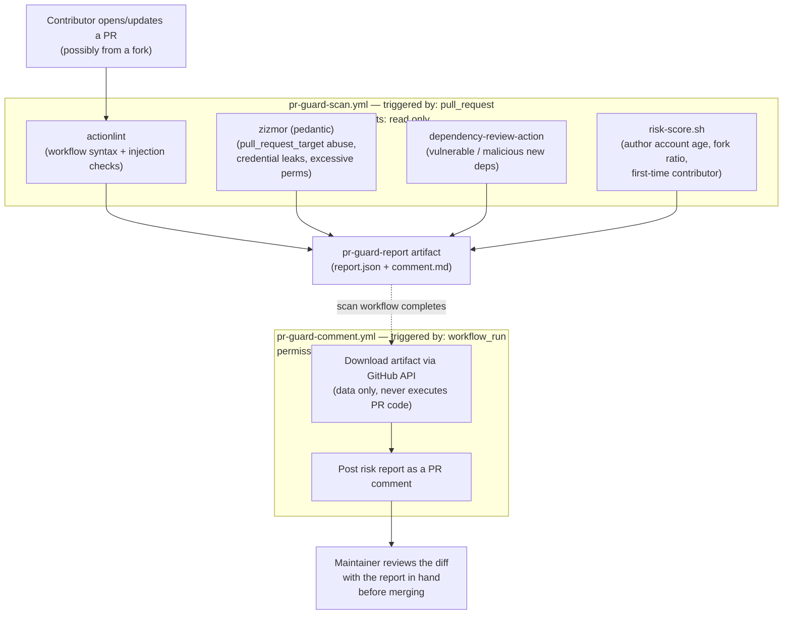

# pr-guard

Reusable workflows that screen external pull requests across BuenDia-Builders
repos before merge: GitHub Actions security linting (`actionlint`, `zizmor`),
dependency review (`dependency-review-action`), and a heuristic risk score on
the PR author's profile (new account, mass-forking pattern, first-time
contributor).

## How it works

Two separate workflows, run in two separate jobs, on purpose: the one that
touches the PR's code never has comment permissions, and the one that can
comment never touches the PR's code. This avoids recreating the classic
`pull_request_target` leak the whole tool exists to catch.



| Step | Workflow | Trigger | Permissions | Runs on attacker's code? | What it does |
|---|---|---|---|---|---|
| 1 | `pr-guard-scan.yml` (calls `reusable-scan.yml`) | `pull_request` | `contents: read` only | Yes, safely (no secrets to steal) | Runs `actionlint`, `zizmor`, `dependency-review-action`, and the risk-score script; writes results to an artifact |
| 2 | `pr-guard-comment.yml` (calls `reusable-comment.yml`) | `workflow_run` (after step 1 finishes) | `pull-requests: write` | No, only reads the artifact's JSON/Markdown | Posts the risk report as a PR comment |

## What the risk score checks

| Signal | Threshold | Points |
|---|---|---|
| Account age | younger than 30 days | +2 |
| Fork pattern | more than 15 forked repos and ≤1 original repo | +3 |
| Contribution history | first PR to this repo | +1 |

Score ≥5 is flagged `HIGH`, 3-4 is `medium`, below that is `low`. This is the
exact signature seen on the accounts that were mass-forking Stellar bounty
repos and sneaking malicious contributions into point-based programs.

## Installing it on a repo

Copy the two files from `templates/` into the target repo's
`.github/workflows/`:

```
templates/pr-guard-scan.yml    -> .github/workflows/pr-guard-scan.yml
templates/pr-guard-comment.yml -> .github/workflows/pr-guard-comment.yml
```

Nothing else to configure. Both files just `uses:` the reusable workflows in
this repo, pinned to `@v1`.

### Known limitation: the comment doesn't appear on the very first PR

`pr-guard-comment.yml` is triggered by `workflow_run`, and GitHub only wires
up `workflow_run` triggers for workflow files that are already on the
repository's **default branch**. That means:

- The PR that *adds* `pr-guard-comment.yml` will never get the risk-report
  comment on itself, even though `pr-guard-scan.yml` runs fine on it.
- The comment starts showing up starting with the next PR, once this one has
  been merged through your normal flow into the default branch.

This is a GitHub platform limitation, not a bug in this repo, and it's the
same for any reusable `workflow_run`-based setup. If your repo has a
branch-promotion policy (e.g. PRs to `main` must come from `develop`), the
comment workflow only goes live once it lands on `main` through that same
path — there's no shortcut around it.

## How this compares to what already exists

`pr-guard` is not a replacement for any of these — it's a thin orchestrator
that wires them together plus one heuristic none of them run. Numbers below
are live GitHub stats (stars / forks), not estimates.

| Tool | Stars | Forks | What it actually covers | Does it exist as a ready-made GitHub App/Action? | Covers the bounty-farming / mass-forking pattern? |
|---|---|---|---|---|---|
| [`zizmor`](https://github.com/zizmorcore/zizmor) | 6,911 | 279 | Static analysis of GitHub Actions workflows: `pull_request_target` abuse, template injection, credential leaks, excessive permissions | Yes — `zizmor-action` | No |
| [`actionlint`](https://github.com/rhysd/actionlint) | 4,387 | 295 | Syntax + semantic checks for workflow YAML, script injection via untrusted `${{ }}` expressions | Yes — CLI used directly in CI | No |
| [`dependency-review-action`](https://github.com/actions/dependency-review-action) | 933 | 193 | Flags vulnerable/incompatible-license dependencies added in a PR's diff | Yes — official GitHub Action | No |
| [`GuardDog`](https://github.com/DataDog/guarddog) | 1,244 | 126 | Heuristic scan of npm/PyPI packages for known malware indicators | CLI only, no GitHub App | No |
| [`OSSF Package Analysis`](https://github.com/ossf/package-analysis) | 924 | 75 | Dynamically sandboxes a package and observes its real behavior (network, filesystem) | Partial — runs as infra, not a drop-in Action | No |
| [`OSSF Scorecard`](https://github.com/ossf/scorecard) | 5,814 | 762 | Supply-chain health score for a repo (branch protection, pinned deps, CI hygiene, etc.) | Yes — Action + public API | No |
| [`OSSF Allstar`](https://github.com/ossf/allstar) | 1,467 | 156 | Org-wide policy enforcement (branch protection, outside collaborators, dangerous workflows) across every repo at once | Yes — GitHub App, install once per org | No |
| [`Harden-Runner`](https://github.com/step-security/harden-runner) | 1,296 | 125 | Runtime monitoring of the CI runner itself (network egress, file integrity) to catch exfiltration live | Yes — GitHub Action | No |
| [`Semgrep`](https://github.com/semgrep/semgrep) | 17,493 | 1,150 | General-purpose static analysis, can write custom rules for obfuscated/malicious code in any language | Yes — `semgrep-action`, but you write the rules | No |
| [`CodeQL`](https://github.com/github/codeql-action) | 1,669 | 503 | Deep semantic code scanning (GitHub's own), strongest for known vulnerability classes | Yes — built into GitHub code scanning | No |
| **`pr-guard`** (this repo) | — | — | Wires several of the above together for the PRs it watches, plus the author-profile risk score | New, internal to BuenDia-Builders | **Yes — this is the only piece of the stack built specifically for it** |

The gap is real: none of the established, widely-forked tools look at *who*
is sending the PR — only at *what* is in it. The mass-forking signature
(dozens of forks, ~0 original repos, brand-new account) that gave away
`OpensrcLord`/`Hustler490` has to be checked separately, which is what
`risk-score.sh` does. Everything else in `pr-guard` is just correctly wiring
up tools that already exist, rather than reinventing them.

## What it does NOT do

It does not replace reading the diff yourself. It's a first line of defense
against the most common vectors (workflow injection, malicious dependencies,
bounty-farming accounts). The source code itself (e.g. a backdoor hidden in a
contract) still needs a human reviewer.
